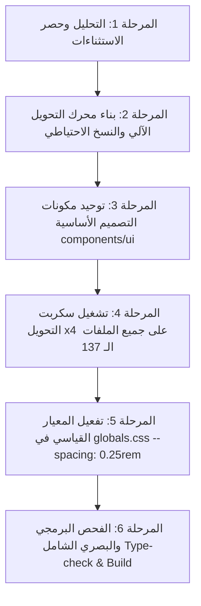

# خريطة العمل الشاملة والمفصلة: توحيد نظام المسافات والمقاسات العام (Tailwind Spacing System Migration)

## 1. التشخيص المعماري وجذر المشكلة (Architectural Root Cause)
- **الموقع المركزي:** `app/globals.css` سطر 11 (`--spacing: 1rem;`).
- **المعيار القياسي في Tailwind CSS v4:** القيمة الافتراضية لـ `--spacing` هي `0.25rem` (أي 4px).
- **الخلل الناشئ:**
  - عند ضبط `--spacing: 1rem`، أصبحت وحدة القياس الأساسية 16px بدلاً من 4px.
  - نتج عن ذلك **انقسام برمجي هجين (Hybrid Paradigm)** عبر 137 ملفاً:
    1. **أكواد حديثة كُتبت بافتراض 1rem:** استخدمت قياسات مقسومة على 4 مثل `p-1` (16px), `p-0.5` (8px), `p-0.25` (4px), `gap-0.5` (8px), `w-10` (160px).
    2. **أكواد ومكتبات منسوخة/مولدة كُتبت بافتراض Tailwind القياسي:** مثل `components/ui/popover.tsx` (`w-72`, `p-4`), `ChatBot.tsx` (`w-64`, `h-64`), `TasbehaHymnModal.tsx` (`h-64`). في هذه الملفات، تضاعفت الأبعاد 4 مرات (أصبح `w-72` يعادل 1152px بدلاً من 288px!).
    3. **تعديلات ترقيعية في shadcn/ui:** مثل `components/ui/button.tsx` حيث تم اختراع أحجام مثل `smallIcon: "h-3 w-3"` وجعلها الافتراضية لأن `default: "h-9"` أصبح ضخماً جداً (144px).

---

## 2. الإحصاء الميداني الدقيق (Codebase Statistical Audit)
تم فحص شجرة المشروع بالكامل عبر سكربت تحليلي مخصص (`scripts/analyze-spacing.mjs` و `scripts/check-values.mjs`):
- **إجمالي ملفات TypeScript:** 243 ملفاً.
- **الملفات المتأثرة بفئات Spacing:** 137 ملفاً.
- **إجمالي الرموز والفئات المتأثرة:** 4,456 فئة.
- **توزيع البادئات الأكثر تكراراً:**
  - الحشو الداخلي (`p-`, `px-`, `py-`, `pt-`, `pb-`): **1,722 موضع**
  - الفواصل بين العناصر (`gap-`, `gap-x-`, `gap-y-`): **760 موضع**
  - الأبعاد (`w-`, `h-`, `min-w-`, `max-w-`): **942 موضع**
  - الهوامش الخارجية (`m-`, `mb-`, `mt-`, `mx-`, `my-`): **482 موضع**
  - التموضع (`top-`, `bottom-`, `left-`, `right-`, `inset-`): **215 موضع**
  - فواصل القوائم (`space-y-`, `space-x-`): **283 موضع**
- **توزيع القيم الرقمية المكتوبة بافتراض 1rem:**
  - `0.5`: 1,435 تكرار (المقصود بها 8px، وتعادل في القياسي `2`)
  - `1`: 901 تكرار (المقصود بها 16px، وتعادل في القياسي `4`)
  - `0.25`: 280 تكرار (المقصود بها 4px، وتعادل في القياسي `1`)
  - `1.5`: 77 تكرار (المقصود بها 24px، وتعادل في القياسي `6`)
  - `2`: 138 تكرار (المقصود بها 32px، وتعادل في القياسي `8`)

---

## 3. مراحل خطة العمل التنفيذية (Execution Roadmap)

### المرحلة 1: التحليل وحصر الاستثناءات (تم إنجازها ✅)
- مسح كامل للـ 243 ملفاً وتحديد الملفات الـ 137 المتأثرة.
- عزل الفئات التي لا تخضع للتحويل (مثل `w-full`, `w-screen`, `w-1/2`, `z-*`, `opacity-*`, `rounded-*`, `border-*`, `duration-*`).
- حصر القيم المعيارية الأصلية في shadcn التي يجب حمايتها من التكرار المزدوج.

### المرحلة 2: بناء محرك التحويل الآلي والنسخ الاحتياطي (تم إنجازها ✅)
- إنشاء السكربت التنفيذي `scripts/migrate-spacing.mjs` المزود بمميزات:
  - دعم وضع المعاينة الآمنة `--dry-run`.
  - إنشاء نقطة استرجاع احتياطية تلقائية (Backup Directory).
  - معالجة جميع صيغ البادئات (`p-`, `m-`, `gap-`, `w-`, `h-`, `inset-`, `top-` وغيرها) مع المتغيرات (`md:`, `hover:`, `dark:`).
  - التحويل الرياضي الدقيق: ضرب القيم في 4 وتبسيط الكسور (مثل `0.5` -> `2`, `0.25` -> `1`, `1` -> `4`, `1.5` -> `6`, `12.25` -> `49`).

### المرحلة 3: توحيد وتصحيح مكونات الواجهة الأساسية `components/ui/` (جاري البدء ⏳)
- إعادة ضبط المكونات المشتقة من shadcn لتعمل بالأبعاد القياسية:
  - `components/ui/button.tsx`: إعادة `buttonVariants` إلى الأبعاد الأصلية (`h-9 px-4 py-2`, `sm: "h-8 px-3"`, `lg: "h-10 px-8"`, `icon: "h-9 w-9"`).
  - `components/ui/input.tsx`: تصحيح الحجم إلى `h-9 px-3 py-1`.
  - `components/ui/card.tsx`: تصحيح الحشو الداخلي إلى `p-6` و `space-y-1.5`.
  - `components/ui/popover.tsx`, `sheet.tsx`, `dropdown-menu.tsx`.

### المرحلة 4: تشغيل محرك التحويل الآلي على كافة صفحات ومكونات المشروع
- تطبيق التحويل على الـ 137 ملفاً دفعة واحدة.
- مراجعة الفروقات (Git Diff) للتأكد من سلامة البنية النصية وعدم المساس بأي كود منطقي أو نصوص عربية.

### المرحلة 5: تفعيل المعيار القياسي في `app/globals.css`
- تعديل السطر 11 في `app/globals.css`:
  - إيقاف `--spacing: 1rem;`
  - اعتماد `--spacing: 0.25rem;` (أو إزالتها ليعمل Tailwind v4 على قيمته القياسية الافتراضية).

### المرحلة 6: الفحص الشامل واختبار الانحدار البصري (Verification & QA)
- تشغيل فحص الأنواع الصارم: `npm run type-check`.
- تشغيل بناء المشروع: `npm run build:no-sitemap`.
- فحص المتصفح والتأكد من مطابقة جميع الصفحات (الرئيسية، الألحان، الكتاب المقدس، لوحة التحكم، الامتحانات).

---

## 4. خطة الأمان والاسترجاع (Safety & Rollback Plan)
1. يتم حفظ نسخة احتياطية لكافة الملفات المستهدفة قبل التعديل.
2. التعديلات تخضع لـ Git ويمكن التراجع عنها فوراً بضغطة زر (`git checkout .`).
3. توفير اختبار تشغيلي بعد كل مرحلة للتحقق من عدم حدوث أي انكماش أو تضخم في الواجهات.
